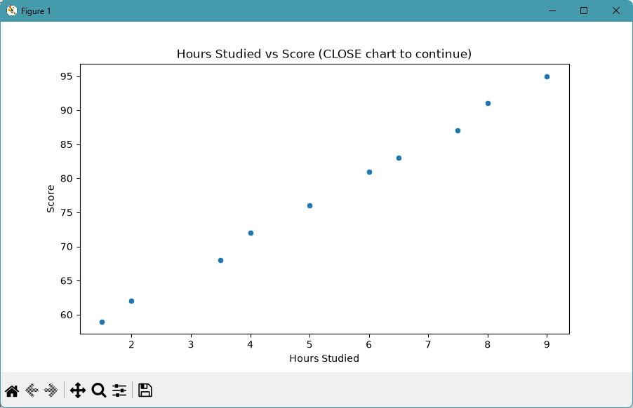
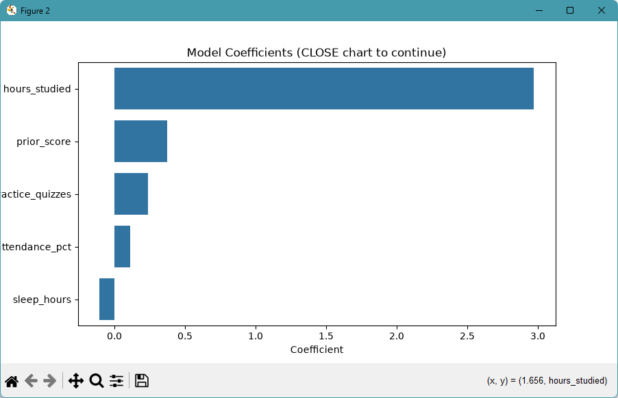

# ml-07-applied-sandra

[](https://denisecase.github.io/pro-analytics-02/workflow-b-apply-example-project/)
[](./pyproject.toml)
[](./LICENSE)

> Professional Python project: investigating a deployed machine learning model.

---

## 👩🏽‍💻 Author

**Sandra Otubushin**

- GitHub: https://github.com/sandra8918
- Repository: https://github.com/sandra8918/ml-07-applied-sandra
- Live Site: https://sandra8918.github.io/ml-07-applied-sandra/

---

## 📌 Project Attribution

This project is based on the original **ml-07-applied** project created by Denise Case. It has been adapted as part of my professional analytics coursework.

---

## Project Description

This project focuses on learning to interrogate a deployed machine learning model by probing it systematically with different inputs.

We learn to:

- call a live prediction API from a notebook
- vary input features and observe how predictions change
- identify decision boundaries and edge cases
- interpret model behavior from the outside

---

## Example Notebook + Your Notebook

Keep the example notebook as it is.
Either copy it or use it to build a new notebook that ends in `_yourname`.

See [docs/your-files.md](docs/your-files.md) for more.

Links:

- [ml_07_case.ipynb](notebooks/ml_07_case.ipynb)

---

## Working Files

You'll work with these areas:

- **data/raw** – raw data for exploration (only if you add a dataset)
- **docs/** – project narrative and documentation
- **src/mlstudio/** – the app is an example; run only (no need to modify)
- **notebooks/** – interactive analysis
- **pyproject.toml** – update authorship and project links
- **zensical.toml** – update documentation settings and links

---

## Additional Packages

This project uses the `requests` package to communicate with the deployed prediction API.

Be sure the `requests` package is listed in `pyproject.toml`.

---

## Instructions (pro-analytics-02)

Follow the
[step-by-step workflow guide](https://denisecase.github.io/pro-analytics-02/workflow-b-apply-example-project/)
to complete:

1. Phase 1. **Start & Run**
2. Phase 2. **Change Authorship**
3. Phase 3. **Read & Understand**
4. Phase 4. **Modify**
5. Phase 5. **Apply**

---

## Challenges

Challenges are expected.

Sometimes instructions may not exactly match your operating system. If issues occur, share screenshots, error messages, and details about what you tried. Working through technical issues is part of implementing professional software projects.

---

## Success

After completing **Phase 1 – Start & Run**, you'll have your own GitHub project with the example notebook executed and committed.

Running the example module should print:

```shell
========================
Executed successfully!
========================
```

A new file `project.log` will appear in the root project folder.

---

## Command Reference

<details>
<summary>Show command reference</summary>

### In a machine terminal (open in your `Repos` folder)

After you get a copy of this repo in your own GitHub account,
open a machine terminal in your `Repos` folder:

```shell
git clone https://github.com/sandra8918/ml-07-applied-sandra.git

cd ml-07-applied-sandra
code .
```

### In a VS Code terminal

```shell
uv self update
uv python pin 3.14
uv lock --upgrade
uv sync --extra dev --extra docs --upgrade

uvx pre-commit install
uvx pre-commit autoupdate

git add -A
uvx pre-commit run --all-files
# repeat if changes were made
uvx pre-commit run --all-files

# run the example module to verify the environment (.venv/)
uv run python -m mlstudio.app_case

# run common chores
uv run ruff format .
uv run ruff check . --fix
uv run python -m pyright
uv run python -m pytest
uv run python -m zensical build

git add -A
git commit -m "Update authorship"
git push
```

</details>

---

## Notes

- Use the **UP ARROW** and **DOWN ARROW** in the terminal to scroll through past commands.
- Use `CTRL+F` to find (and replace) text within a file.
- You do not need to add to or modify `tests/`. They are provided for example only.
- Many files are silent helpers. Explore as you like, but nothing is required.
- You do **NOT** need to understand everything; understanding builds naturally over time.

---

## Troubleshooting

If you see something like this in your terminal:

```text
>>>
```

or

```text
...
```

You accidentally started Python interactive mode.

Press **Ctrl+C** (or **Ctrl+Z** then **Enter** on Windows) to exit.

---


## Example Output (Can Remove this Section after You Verify)

```shell
| INFO | ML | Executed successfully!
```

## Findings and Visuals

Take screenshots of your charts and provide them here with a discussion.
In Markdown, display a figure by using:
an exclamation mark immediately followed by square brackets containing a useful caption
immediately followed by parentheses containing the relative path to your figure.
Note: When you start typing the path with a dot (.) for "here, in this directory",
the IDE may help complete the path.

In your custom project, follow this example, but

- your figures and narrative should reflect your work,
- this `README.md` should include your commands, process, and visuals, and
- `docs/index.md` should include your narrative.

Remove unnecessary instructional comments in your custom files.

Update figures to present interesting results from your custom project:





## Project Documentation

Additional project instructions, terms, and notes:

[docs/index.md](docs/index.md)

## Citation

[CITATION.cff](./CITATION.cff)

## License

[MIT](./LICENSE)
